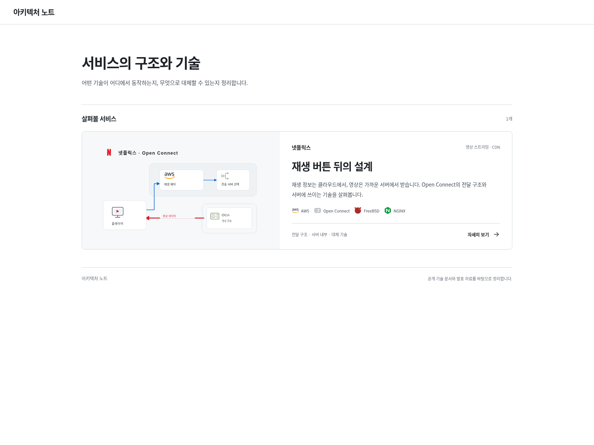
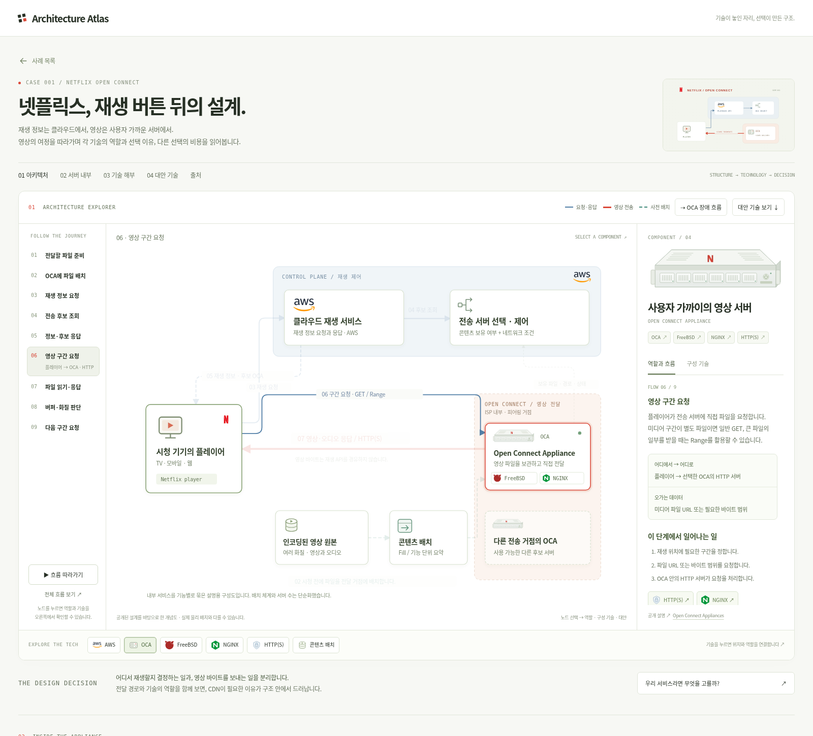
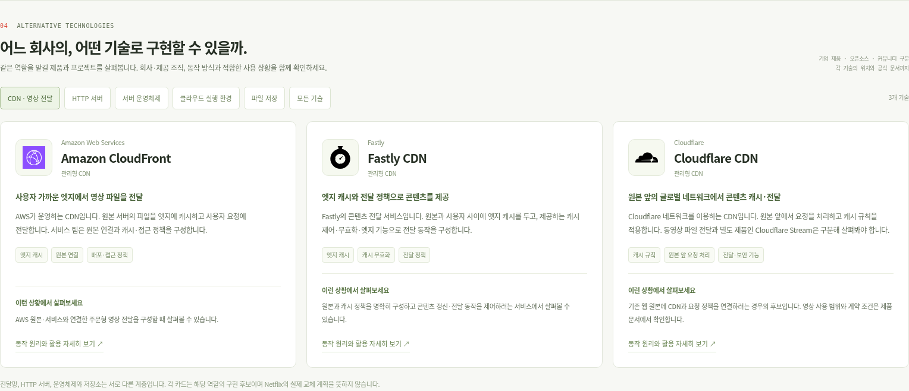
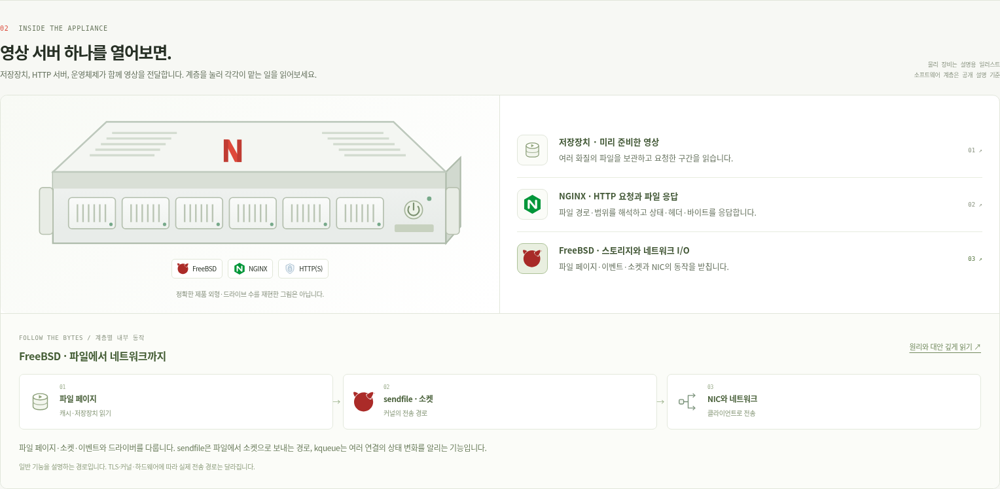
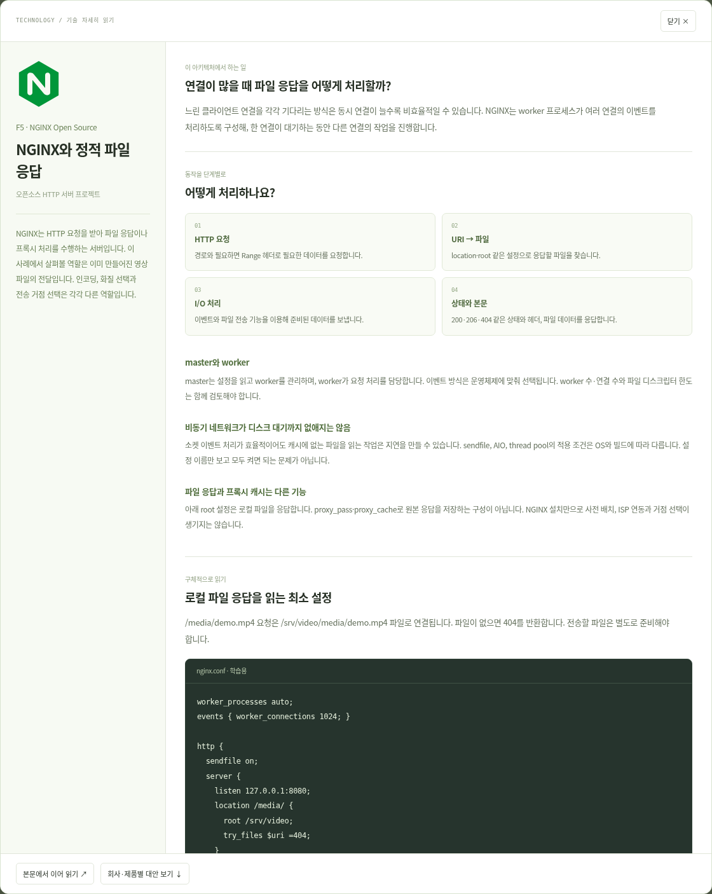
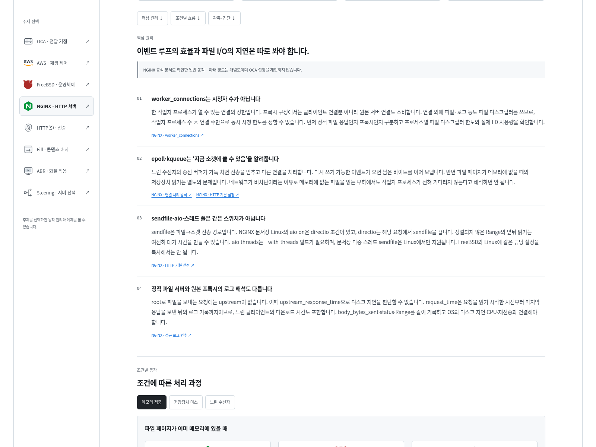

# Architecture Atlas

실제 서비스의 아키텍처를 따라가며 **어떤 기술을 어디에, 왜 쓰는지** 살펴보는 인터랙티브 웹사이트입니다. 기술의 이름을 아는 것에서 더 나아가, 문제와 제약에 맞는 선택을 이해하는 데 목적을 둡니다.

첫 번째 사례는 **「넷플릭스, 재생 버튼 뒤의 설계」**입니다. Open Connect를 중심으로 재생 정보가 오가는 경로, 실제 영상이 전달되는 경로, 시청 전에 콘텐츠를 준비하는 과정을 구분해 보여줍니다.



## 살펴볼 수 있는 것

- **카드 목록 → 상세 화면:** Chrome의 기본 View Transition API로 카드 배경·표지·제목을 연결합니다. 목록 복귀와 브라우저 뒤로/앞으로 이동을 지원합니다.
- **데이터 흐름:** 요청·응답은 파랑, 영상 전송은 빨강, 콘텐츠 배치는 청록 점선으로 구분합니다. 파일 준비부터 다음 구간 요청까지 9단계를 따라가며 요청 주체·데이터·처리 기술을 확인합니다.
- **오른쪽 상세 패널:** 역할과 흐름·구성 기술 두 탭으로 탐색합니다. 구성 기술 행을 누르면 넓은 기본 dialog에서 제공 조직·동작 순서·예제·공식 문서를 읽습니다.
- **회사·제품별 대안:** 본문 아래에 11개 기술을 CDN·HTTP 서버·OS·클라우드·저장소로 나눠 소개합니다. 회사·제공 조직, 제품명, 로고, 기능과 적합한 상황을 카드와 상세 창으로 확인합니다.
- **서버 내부 탐색:** 저장장치·NGINX·FreeBSD 계층을 선택하면 파일·요청·커널·네트워크의 처리 순서를 볼 수 있습니다.
- **기술 상세 읽기:** 기술 6개와 재생·서버 선택의 설계 2개를 문제 → 동작 원리 → 예제 → 대안 → 검증 지표 순서로 읽습니다. 기술 로고와 단계별 흐름을 함께 표시합니다.
- **계산하며 이해하기:** 동시 시청자·비트레이트에 따른 전달 용량과, 네트워크 처리량에 따른 구간 수신 시간·다음 화질 후보를 값을 바꿔 살펴봅니다.
- **기본 접근성:** 키보드 선택, 탭 이동, 포커스 복원, 모션 감소 설정을 지원합니다. View Transition API가 없는 환경에서는 즉시 화면을 전환합니다.



왼쪽의 9단계를 선택하면 오른쪽 역할과 흐름 탭에 요청 주체, 전달 데이터, 처리 순서와 설명용 요청·응답이 표시됩니다. 구성 기술을 누르면 원리와 예제를 크게 읽을 수 있습니다. **대안 기술 보기**는 선택한 역할에 맞는 회사·제품 카드로 이동합니다.





## 기술을 깊게 읽기

구성도의 상세 설명에서 **원리·동작·예제를 크게 보기**를 누르거나, 본문의 **03 기술 해부**에서 주제를 선택하세요. 각 글의 주소를 직접 공유할 수 있습니다. 예를 들어 `?case=netflix#tech-nginx`는 NGINX 글을 바로 엽니다.



| 주제 | 상세 내용 |
| --- | --- |
| OCA | ISP 가까이의 파일 전송, 디스크·네트워크 병목, 시청자 수에 따른 용량 계산 |
| AWS와 재생 제어 | 제어·전송 경로 분리, 증설 단위, 가상 API 응답과 의존 서비스 지연 |
| FreeBSD | kqueue, sendfile, 부분 전송과 EAGAIN, Linux와의 비교 조건 |
| NGINX | master·worker, 이벤트 처리, 파일 응답 설정, 파일 디스크립터와 I/O |
| HTTP(S) | Range·206 응답, TLS와 DRM의 구분, HTTP/2·HTTP/3·WebRTC 비교 |
| 콘텐츠 배치 | 사전 배치·요청 시 캐시, 바이트 적중률, 캐시 키와 TTL |
| 플레이어·ABR | 여러 화질의 구간, 버퍼·처리량, 화질 선택의 계산 예제 |
| 서버 선택 | 파일·네트워크·용량 조건, 상태 정보 지연, 재시도 예산과 장애 대응 |



예제 설정·API 응답·수치는 학습용이며 Netflix의 실제 내부 설정이나 알고리즘을 뜻하지 않습니다. 확인한 문서와 추가 읽기 자료의 접근 범위는 각 글 하단에 표시합니다.

## 바로 열어보기

[`openconnect-visual-study.html`](openconnect-visual-study.html)을 다운로드해 Chrome에서 여세요. CSS, JavaScript, 이미지, 아이콘과 서체가 포함된 단일 파일로, 설치나 외부 이미지 서버 없이 동작합니다.

메인에서 넷플릭스 카드를 선택하면 상세 화면이 열립니다. 구성도의 노드나 기술 배지에서 상세 글로 이동하고, 글에서는 해당 역할의 구성도로 돌아갈 수 있습니다. 기술 요약 카드와 참고 도식은 접을 수 있는 자료에 모았습니다.

## 로컬 개발

실행에는 **Python 3.9 이상**만 있으면 됩니다. 브라우저 테스트에는 **Node.js 20 이상**이 필요합니다.

```sh
git clone https://github.com/LeeJams/architecture.git
cd architecture
python3 -m http.server 8765 --bind 127.0.0.1
```

브라우저에서 `http://127.0.0.1:8765`를 엽니다. Node.js를 사용하는 경우 `npm run dev`로도 같은 개발 서버를 실행할 수 있습니다.

별도의 프런트엔드 프레임워크나 애플리케이션 서버가 필요하지 않은 정적 HTML·CSS·JavaScript 구성입니다.

| 파일 | 역할 |
| --- | --- |
| `index.html` | 사례 목록, 상세 화면, SVG 아키텍처 구성도 |
| `styles.css` | 화면 배치, 반응형 스타일, 기본 View Transition 표현 |
| `app.js` | 구성 요소·기술 설명, 경로 강조, 화면 이동과 인터랙션 |
| `technology-notes.js` | 8개 상세 주제의 원고, 예제, 대안·지표와 출처 |
| `technology-reader.js` · `technology-reader.css` | 상세 글·키보드 탭·직접 링크·계산 예제와 반응형 읽기 화면 |
| `architecture-insights.js` · `architecture-insights.css` | 구성도의 입력·처리·출력 설명과 서버 계층 탐색 |
| `architecture-journey.js` | 9단계 요청·응답·파일·플레이어 흐름 |
| `alternative-catalogue.js` | 11개 제품의 제공 조직·기능·활용 설명 |
| `technology-sheet.js` · `technology-explorer.css` | 기술·제품 상세 dialog와 대안 카드의 반응형 화면 |
| `assets/` | 자체 도식, 기술 로고, 참고 이미지, 서체와 고지 |
| `scripts/` | 단일 HTML 생성과 브라우저 검증 도구 |
| `docs/images/` | 메인과 상세 화면 예시 |

## 단일 HTML 만들기

소스나 에셋을 수정한 뒤 다음 명령으로 다운로드용 파일을 갱신합니다.

```sh
python3 scripts/build-standalone.py
```

또는 `npm run build`를 실행합니다. 생성되는 `openconnect-visual-study.html`에는 필요한 이미지와 서체, 라이선스 고지가 함께 들어갑니다. 생성 파일도 소스와 함께 커밋합니다.

포함된 WOFF 서체는 현재 콘텐츠에 필요한 글리프를 추린 파일입니다. 새로운 문자를 추가할 때는 서체 범위와 대체 서체에서의 배치도 확인해야 합니다.

## 검증

```sh
npm ci
npx playwright install chromium
npm test
```

`npm test`는 임시 로컬 서버를 자동으로 시작하고 검증이 끝나면 종료합니다. 결과는 Git에서 제외된 `reports/`에 저장됩니다.

- `verify-ui.cjs`: 320~2560px의 **19개 화면 폭·1,026개 상태**에서 목록·상세·8개 기술 글·9단계 흐름·상세 dialog·대안 카드·서버 내부 계층·요약 카드·참고 자료의 배치, 텍스트 넘침, SVG 라벨 겹침, 이미지와 JavaScript 오류를 확인합니다. 노드·기술 선택, 흐름 재생, 키보드와 이미지 확대도 검사합니다.
- `verify-navigation.cjs`: 실제 View Transition의 준비·완료, 카드 열기·복귀, 뒤로/앞으로, 스크롤·포커스 복원, 빠른 취소, 상세 주소 직접 열기, 모션 감소 및 API 미지원 처리를 확인합니다.
- `verify-technology.cjs`: 기술 글의 직접 링크·새로고침·키보드·구성도 연결, 용량 계산의 잘못된 입력, 저속 네트워크에서의 화질 후보, 좁은 화면의 표·코드 스크롤과 단일 HTML의 오프라인 실행을 검사합니다.
- `verify-explorer.cjs`: 두 탭·9단계 흐름, 기술 상세 dialog의 포커스·닫기·맥락 유지, 11개 제품의 제공 조직과 상세 설명, 역할별 목록 이동과 기존 서버 내부 탐색을 검사합니다.

시스템에 `/usr/bin/chromium`이 있으면 이를 사용하고, 없으면 Playwright가 설치한 브라우저를 사용합니다. 다른 실행 파일은 `ATLAS_CHROMIUM_EXECUTABLE` 환경 변수로 지정할 수 있습니다.

검증 결과는 해당 Chromium과 화면 조건에서의 결과이며 모든 브라우저·기기 설정에 대한 보증은 아닙니다.

## 콘텐츠의 범위와 출처

구성도는 공개된 설계를 읽기 위한 **기능 단위의 설명용 재구성**입니다. Netflix의 현재 내부 전체 구성, 정확한 물리 배치, 특정 소프트웨어 버전이나 모든 장애 복구 절차를 재현하지 않습니다. 대안 비교는 학습을 위한 제안이며 Netflix의 실제 전환 계획을 뜻하지 않습니다.

원문, 참고 도식, 확인이 남은 범위는 [SOURCES.md](SOURCES.md)에 정리했습니다. 외부 이미지·아이콘·서체에는 서로 다른 라이선스가 적용되므로 [THIRD_PARTY_NOTICES.md](THIRD_PARTY_NOTICES.md)와 함께 확인하세요.
