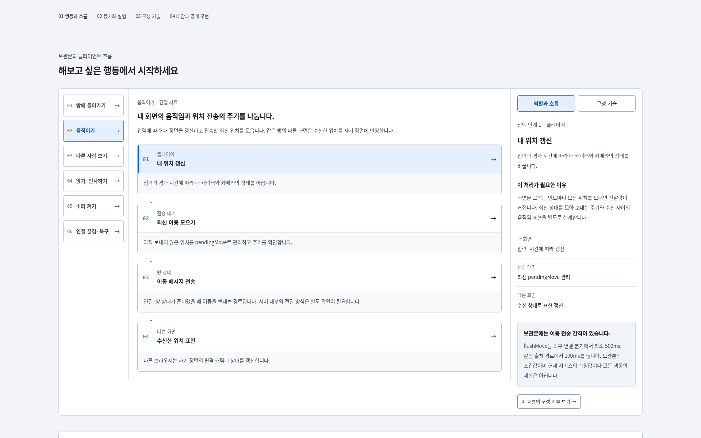

# 아키텍처 노트

서비스의 구조를 따라가며 **기술의 역할과 선택 이유를 배우는 웹사이트**입니다.

AI로 코드를 작성하기 쉬워질수록, **어떤 문제를 어떤 기술로 풀지 판단하는 힘**이 중요하다고 생각합니다. 공개된 서비스 아키텍처와 공식 기술 문서를 함께 읽고, 그 판단의 근거를 쌓아가려 합니다.

## 무엇을 다루나요?

- **서비스의 동작 흐름** — 요청과 데이터가 어디를 지나고, 각 구성 요소가 무슨 일을 하는지 그림을 따라가며 살펴봅니다.
- **서비스별 기술 구성** — 프론트엔드·서버·데이터 저장으로 나눠 보고, 영역별 상세에서 사용 기술과 처리 방식을 살펴봅니다.
- **기술이 필요한 이유** — 해결하려는 문제부터 동작 원리, 도입해서 얻는 것과 감수할 조건까지 설명합니다.
- **대체할 수 있는 기술** — 어떤 역할을 어느 회사의 어떤 제품으로 바꿀 수 있는지, 연결할 때 무엇을 확인해야 하는지 정리합니다.

현재 **산사의 3D 공간·실시간 동기화**와 **넷플릭스의 영상 전달·Open Connect**를 다룹니다. 산사는 클라이언트 보관본을 읽은 간접 자료와 설명용 실험, 공개 비교 구현을 구분합니다. 넷플릭스는 재생 정보와 영상 파일이 전달되는 흐름을 따라갑니다.

기술 목록에서는 언어·프레임워크·저장·관측 도구 등 **21개 분류의 100개 기술**을 살펴봅니다. 예를 들어 Kafka는 동기·비동기 처리를 직접 바꿔보며 **접수 응답과 후속 작업 완료의 차이**, 장애와 재시도에서 생기는 중복 가능성을 확인합니다.



## 함께 만들기

이해되지 않는 설명이 있다면 그 부분을 알려주세요. 설명을 보완하거나 새로운 사례를 선정하는 데 도움이 됩니다. 공식 자료를 보태거나, 도식과 화면을 고치거나, 직접 살펴본 아키텍처를 소개하는 기여도 환영합니다.

- 질문·오류 제보·새로운 사례 제안은 [이슈](https://github.com/LeeJams/architecture/issues)에 남겨주세요.
- 원고나 코드를 수정하고 싶다면 [기여 안내](CONTRIBUTING.md)에서 작성 위치와 확인 방법을 살펴보고 PR을 보내주세요.

여러 개발자의 질문과 경험을 모아, 기술을 선택할 때 다시 찾아볼 수 있는 자료로 키워가고 싶습니다.

## 실행하기

Node.js 20.19 이상이 필요합니다. React + Vite로 만들었습니다.

```sh
git clone https://github.com/LeeJams/architecture.git
cd architecture
npm ci
npm run dev
```

브라우저에서 `http://127.0.0.1:5173`을 엽니다. 설치 없이 살펴보려면 [단일 HTML](openconnect-visual-study.html)을 내려받아 Chrome에서 열 수 있습니다.

빌드·테스트·컴포넌트 작업대 실행 방법은 [기여 안내](CONTRIBUTING.md#변경-확인하기)에 정리했습니다.

[자료와 설명 범위](SOURCES.md) · [이미지·서체 라이선스](THIRD_PARTY_NOTICES.md)
