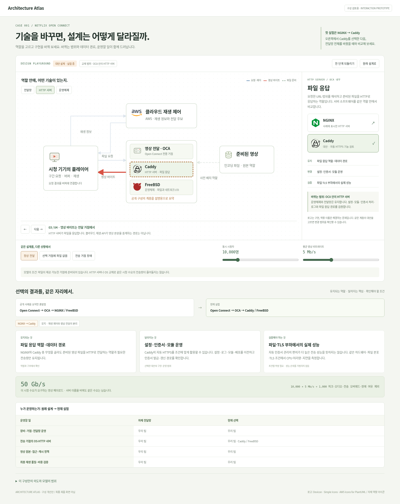

# 개선안: 기술 선택이 구조와 결과로 보이는 설계 실험실

## 목표

사용자가 한 화면에서 **무슨 역할인지 → 무엇으로 구현했는지 → 무엇으로 바꿀 수 있는지 → 바꾸면 무엇이 달라지는지** 연결해서 이해하게 한다.

현재 사이트의 상세 원고는 참고 자료로 활용하고, 사례의 주 화면은 선택과 비교를 중심으로 재구성한다. [클릭 가능한 구성 검토용 프로토타입](playground.html)을 함께 제공한다. 프로토타입은 Netflix의 시스템을 실행하거나 성능을 재현하는 시뮬레이터가 아니다.



## 현재 구성에서 생기는 이해 비용

1. 구성도, 서버 내부, 기술별 글, 비교표가 떨어져 있다. 기술을 읽는 동안 전체 구조와 선택의 영향을 기억해야 한다.
2. 클라우드 플랫폼, 전달망, HTTP 서버, 운영체제, 설계 패턴의 범위가 비슷하게 표현된다. 무엇끼리 비교해야 하는지 먼저 알아야 한다.
3. 기술을 바꿔도 도식이 변하지 않는다. 장단점은 읽을 수 있지만 영향을 받는 경계와 연결이 보이지 않는다.
4. ‘흐름 재생’은 연결선을 강조하지만 사용자의 선택이 결과에 연결되는 경험은 적다.
5. 정보량은 늘었지만 처음 방문한 사람이 어디를 눌러 어떤 이해를 얻어야 하는지 약하다.

## 제안하는 전체 구성

### 1. 사례 입구: 문제와 세 가지 선택을 미리 보여주기

카드 목록과 기본 View Transition은 유지한다. 사례 카드에는 기술 로고 외에 탐색할 질문을 제시한다.

> 넷플릭스, 재생 버튼 뒤의 설계
>
> 영상은 왜 사용자 가까이에서 보낼까?
>
> 바꿔 볼 선택: 전달망 · HTTP 서버 · 운영체제

사례 첫 화면에서는 공개 설계의 핵심 한 문장과 간결한 구조가 먼저 보인다. 전문 용어 설명은 선택한 역할에 맞춰 제공한다.

### 2. 중심 화면: 구성도와 교체 패널을 한 자리에

```text
NETFLIX / 영상 전달                      [사례 설계] [변경 되돌리기]
지금 선택: OCA → HTTP 서버

┌────────────────────────────┬─────────────────────────┐
│ 재생 제어                  │ 선택한 역할: 파일 응답   │
│    ↕                       │ 현재 구현: NGINX         │
│ 플레이어 ← OCA ← 영상 원본  │                         │
│            ├ NGINX         │ [NGINX] [Caddy]          │
│            └ FreeBSD       │                         │
│                            │ 교체 범위 / 연결된 역할  │
│ [이전 단계] ③ 영상 응답     │ 유지 / 변경 / 검증       │
├────────────────────────────┴─────────────────────────┤
│ 상황: [정상] [파일 없음] [거점 장애]                    │
│ 수요: 시청자 수 · 평균 비트레이트 → 필요한 전송량        │
├──────────────────────────────────────────────────────┤
│ 변경 전 → 현재 실험  |  구조·운영 책임·검증할 항목        │
└──────────────────────────────────────────────────────┘

[원리 더 읽기]  [이 선택의 근거]  [내 조건에 적용하기]
```

구성도에는 **역할 이름**을 크게, 그 역할의 **제품·기술 로고**를 함께 표시한다. OCA를 선택하면 내부의 HTTP 서버와 운영체제가 드러나고, 해당 계층을 골라 비교한다. 원래 사례와 사용자가 수정한 대안 설계를 항상 구분한다.

### 3. 기술 교체: 바뀌는 범위를 직접 보여주기

| 선택 | 도식에서 변하는 범위 | 즉시 전달할 내용 | 단정하지 않을 내용 |
| --- | --- | --- | --- |
| NGINX → Caddy | OCA 내부 HTTP 서버 한 계층 | 파일 응답 역할과 전달 경로 유지, 설정·모듈·인증서 운영 재검토 | 더 빠르다 / CPU가 몇 % 줄어든다 |
| FreeBSD → Linux | OS·이벤트·드라이버 계층 | NGINX·파일 역할 유지, kqueue/epoll 등 I/O·관측·드라이버 검증 | OS 이름만으로 정한 전송 성능 |
| 자체 전달망 → 관리형 CDN | 거점·콘텐츠 준비·라우팅·전송 운영 경계 | 사업자가 맡는 운영과 우리에게 남는 원본·정책·품질 검증 | 모든 책임이 없어짐 / 항상 저렴함 |

교체할 때 해당 부분이 강조되고 변경 요약이 갱신된다. 기존 노드는 위치를 유지해 사용자가 바뀐 범위를 추적할 수 있게 한다. 변경을 한 단계 되돌리고 원래 설계로 복원할 수 있어야 한다.

관리형 CDN을 선택하면 OS·HTTP 서버가 사업자 내부 영역으로 묶인다. 이 상태에서 Caddy나 Linux를 직접 고르는 제어는 제공하지 않는다. CloudFront의 실제 내부 OS·HTTP 서버를 추정해서 표시하지 않는다.

### 4. 상황 실험: 같은 선택을 다른 조건에서 보기

최초 구현은 세 가지 상황으로 제한한다.

- **정상 전달:** 재생 정보와 영상 바이트의 경로를 요청 한 건씩 따라간다.
- **선택한 거점에 파일 없음:** OCA에서는 파일을 가진 다른 후보, 요청 시 캐시로 가정한 CDN에서는 원본 조회라는 설명 모델의 차이를 보여준다. 조건과 정책을 먼저 표시한다.
- **거점 장애:** 실패 지점과 다른 후보를 강조하고 파일 보유·여유 용량·재시도 예산이 필요하다는 결과를 보여준다. 자동·무중단 복구를 보장하지 않는다.

다음 단계에서만 원본 병목, 캐시 준비 상태, 이동 네트워크와 플레이어 버퍼를 추가한다. 화면마다 독립적인 장난감 컨트롤을 늘리기보다 한 가지 원인 변화가 도식과 결과를 함께 바꾸게 한다.

### 5. 결과: 점수 대신 무엇이 변했는지

선택한 기술의 아래에는 세 가지 결과만 먼저 표시한다.

이 세 가지는 교체 패널 안에 짧게 표시해 스크롤 없이 선택의 의미를 볼 수 있게 한다. 자세한 설명, 전체 변경 전후와 운영 책임 표는 이어지는 비교 영역에서 읽는다.

- **유지되는 것:** 역할, 인터페이스, 전달 데이터 또는 필요한 전송량.
- **달라지는 것:** 배포·설정·인증서·드라이버·장비·운영 주체.
- **검증할 것:** 처리량, p95 지연, 비용, 기기·네트워크 호환성, 장애 복구.

정량 값은 계산 가정을 열어 볼 수 있게 한다. 예를 들어 동시 시청자 10,000명 × 5 Mb/s = 영상 페이로드 50 Gb/s는 계산할 수 있다. HTTP 서버를 교체했다고 이 수요가 줄어드는 것은 아니다. 월 비용은 지역·전송량·요청 수·단가·고정비·인력을 넣은 경우에 계산하고, 실제 재생 지연과 처리량은 벤치마크가 필요하다고 표시한다.

효과는 `구조에서 확인`, `가정으로 계산`, `측정 필요`로 구분한다. 출처나 가정을 결과 가까이에 붙여 설명의 근거를 이해할 수 있게 한다.

### 6. 깊은 내용: 선택한 맥락에서 펼치기

현재 8개 상세 글은 다음과 같이 연결한다.

1. 첫 화면에는 한 문장 역할, 작은 내부 도식, 핵심 선택 이유를 표시한다.
2. ‘내부 동작 보기’를 누르면 그 자리에서 파일→커널→소켓 또는 요청→파일 응답을 펼친다.
3. 설정·헤더·원문은 보조 읽기 영역에서 연다. 전체 구조를 떠나 긴 페이지를 왕복할 필요를 줄인다.
4. 대안의 세부 내용은 같은 항목끼리 비교한다. ‘설정 방식 / I/O 경로 / 인증서 / 관측 / 이전 작업’ 등 역할마다 필요한 비교 항목을 다르게 정한다.

## 한 사용자가 1분 동안 해 볼 흐름

1. **영상 요청 따라가기:** 클라우드가 재생 정보를 주고 OCA가 영상 바이트를 보내는 것을 확인한다.
2. **OCA 내부의 NGINX 선택:** ‘파일 응답’이라는 역할과 ‘HTTP 서버’라는 범위를 본다.
3. **Caddy 선택:** 내부 로고와 설정·인증서 관련 설명이 바뀌고 영상 전달 경로·필요 대역폭은 유지되는 것을 본다.
4. **관리형 CDN 선택:** 전달망 경계가 바뀌고 OS·HTTP 서버 직접 관리가 사업자 영역으로 옮겨지는 것을 본다.
5. **파일 없음 선택:** 어떤 조건에서 다른 거점 또는 원본으로 요청이 이어지는지 비교한다.

마지막에는 ‘어떤 기술이 더 좋은가’보다 **‘어떤 역할을 어느 범위까지 맡기며, 무엇을 검증해야 하는가’**를 말할 수 있어야 한다.

## 첫 구현 범위와 완료 기준

첫 구현의 중심은 전달망·HTTP 서버·운영체제 세 가지 교체다. AWS 사업자 교체와 ABR·코덱 실험은 다음 단계로 둔다. 비교 축과 선택의 영향을 먼저 선명하게 만든다.

- 역할 선택, 대안 선택과 결과 표시가 한 화면에서 연결된다.
- 교체 전후에도 무관한 노드의 위치를 유지하고 바뀐 경계를 표시한다.
- 같은 시청 수요를 유지한 비교에서 서버 이름만으로 지연·비용·처리량 우위를 만들지 않는다.
- 관리형 영역에서 구현을 직접 선택할 수 있는 것처럼 보이지 않는다.
- 모바일은 간략한 세로 구성도와 이어지는 선택 패널을 사용한다. 작은 데스크톱 구성도를 축소해 읽게 하지 않는다.
- 색 외에도 역할 이름·범위·변경 배지로 상태를 표현하고, 키보드·모션 감소·되돌리기를 지원한다.
- 처음 방문한 사용자가 영상 경로, NGINX의 역할, Caddy로 교체되는 범위, CDN 선택 시 남는 운영 책임을 설명할 수 있는지 확인한다.

## 프로토타입의 위치와 한계

`docs/proposals/playground.html`은 구성 검토용 독립 화면이다. 원래 사례 페이지에 곧바로 적용한 최종 디자인은 아니다. 원고를 모두 옮기는 대신 **역할 선택·부분 교체·운영 경계·조건별 경로·변경 요약**의 연결이 전달되는지 확인한다.

기술 사실과 출처 범위는 기존 [SOURCES.md](../../SOURCES.md) 및 [THIRD_PARTY_NOTICES.md](../../THIRD_PARTY_NOTICES.md)를 따른다. 구성 검토용 그래픽은 설명 모델이며 현재 Netflix의 내부 구현이나 CloudFront 내부 동작을 재현하지 않는다.
