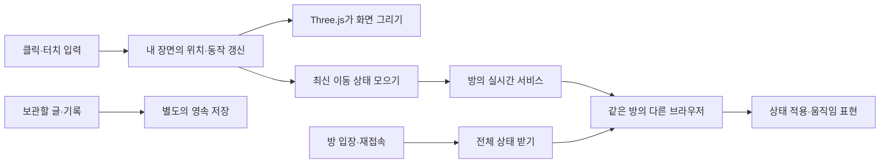

# 산사에서 시작하는 체험형 웹서비스 분석

조사 기준: 2026-11-03, 한국 시간. 공개 README·의존성·클라이언트 코드의 정적 분석입니다.

추천하는 방향은 **앱에서 해본 행동을 출발점으로, 그 행동을 가능하게 하는 기술과 필요한 이유를 설명하는 사이트**입니다. 산사의 방에 들어가고, 움직이고, 다른 방문자를 보고, 소리를 듣는 경험을 각각 렌더링·상태 동기화·연결 복구·오디오 처리로 이어갈 수 있습니다.

## 조사 범위와 근거

- 사용자가 알려준 원본은 [sansatemple.com](https://sansatemple.com/)입니다. 공식 사이트와 [나무위키 문서](https://namu.wiki/w/%EC%82%B0%EC%82%AC(%EC%9B%B9%EC%82%AC%EC%9D%B4%ED%8A%B8))는 이 환경의 네트워크 프록시에서 403으로 차단됐습니다. Chromium 접근도 실패했습니다. 두 페이지의 현재 화면·본문·배포 상태를 직접 확인했다고 주장하지 않습니다.
- GitHub에서 원본 도메인을 언급한 최근 공개 프로젝트를 찾고, README에 적힌 기술을 실제 코드와 대조했습니다. 산사 원본, 산사에 영향을 받은 프로젝트, 다른 도메인의 동명 프로젝트를 구분했습니다.
- 특히 `davidkimyang/metatemple`은 산사 클라이언트 보관본을 포함한다고 명시합니다. 보관본과 변환 스크립트는 읽었지만, 산사 현재 배포본과 바이트를 대조하거나 저장소의 재사용 허가 주장을 검증하지는 못했습니다. **산사에 관한 간접 자료**로 취급합니다.
- 비교 앱들은 **최근 갱신된 관련 공개 구현**입니다. 저장소 업데이트나 비슷한 프로젝트의 존재가 대중적 유행·실사용자 수를 입증하지는 않습니다. 이번 조사는 인기 순위가 아닙니다.
- 비교 앱의 서버·DB를 실행하거나 공개 방에 테스트 사용자를 넣지 않았습니다. 아래 동작은 코드에서 확인한 구현이며, 운영 부하·동시 접속 성능의 검증 결과가 아닙니다.

읽은 파일의 고정 커밋·원문 URL·바이트 수·SHA-256은 [출처 기록](2026-11-03-playful-web-sources.json)에 보관합니다.

## 1. 산사: 3D 장면 뒤에 있는 실시간 상태 처리

### 보관본에서 읽을 수 있는 기술

[산사 보관본이라는 파일](https://github.com/davidkimyang/metatemple/blob/351c9d843926cc1dace323c4e65da58413e0d924/reference/vendor/sansa-game.js)과 [이를 변환하는 스크립트](https://github.com/davidkimyang/metatemple/blob/351c9d843926cc1dace323c4e65da58413e0d924/scripts/reference/prepare-reference.mjs)가 근거입니다. 아래 내용은 이 보관본에 한정합니다.

| 기술·구조 | 코드에서 확인한 내용 | 왜 필요한가 |
| --- | --- | --- |
| Three.js | 렌더링 캔버스에 `three.js r180`을 표시하고 장면·카메라·조명·방문자 표시를 구성 | 브라우저에서 3D 공간과 사람의 동작을 그리기 위해 사용 |
| Web Audio API | `AudioContext`, 환경음·효과음 버스, 필터·압축·잔향 처리를 구성 | 공간의 소리와 행동의 피드백을 따로 조절하고 사용자 조작 후 재생하기 위해 사용 |
| WebSocket | `bE` 클래스가 연결·이동·방 전환·좌석 요청·상태 수신을 처리 | 같은 방에 있는 방문자의 상태와 행동을 주고받기 위해 사용 |
| Cloudflare Workers 도메인 | 기본 WebSocket 주소가 `workers.dev`의 `/presence` 경로를 가리킴 | 클라이언트가 접속할 실시간 서비스 주소의 단서. 서버 내부 구현까지 확인한 것은 아님 |
| 방·인스턴스·리전 | `room`, `instance`, `region`을 URL과 연결 상태에서 다룸 | 공유 링크의 접속 맥락과 방 선택을 유지하기 위해 사용 |
| 스냅샷·증분·revision | 전체 상태와 `delta`를 구분하고 revision 불일치 시 `sync`를 요청 | 놓친 변경이나 오래된 상태를 감지하고 다시 맞추기 위해 사용 |
| 브라우저 저장 | `sansa:` 접두사를 붙여 설정을 localStorage에서 읽고 씀 | 장치 안에서 소리 등 사용자 설정을 유지하기 위해 사용 |

Supabase URL과 공개 설정값도 있지만, 초기화 분기는 외부 WebSocket 주소가 비어 있을 때만 Supabase 경로를 선택합니다. **설정 문자열이 있다는 이유만으로 현재 산사의 실시간 처리가 Supabase를 사용한다고 확정할 수 없습니다.** 실제 운영 DB, Workers 내부의 Durable Objects 사용 여부, Redis·Kafka·Kubernetes 사용 여부는 확인되지 않았습니다.

파생 프로젝트인 metatemple의 React·Vinext·D1과 자체 presence 구현도 산사 원본의 스택으로 옮겨 적으면 안 됩니다. [파생 프로젝트 README](https://github.com/davidkimyang/metatemple/blob/351c9d843926cc1dace323c4e65da58413e0d924/README.md)는 이 변경을 별도로 설명합니다.

### 설명할 만한 중요한 디테일

**화면을 그리는 빈도와 이동을 전송하는 빈도가 다릅니다.** 보관본의 `flushMove()`는 외부 서비스 연결에서 최소 500ms, 같은 출처 경로에서 100ms의 이동 전송 간격을 둡니다. 전송 전 대기 중인 이동은 `pendingMove`로 관리합니다. 외부 연결의 500ms는 보관본의 조건값이며 현재 산사의 실제 측정값이나 모든 동작의 제한을 뜻하지 않습니다.

우리 설명에서는 이동 전송 간격을 바꿀 때 통신량과 다른 사람의 움직임이 어떻게 달라지는지 보여주면 좋습니다. 매 프레임의 위치를 전부 보내는 대신 최신 상태를 보내는 이유, 수신 사이의 움직임을 표현하는 방법을 연결할 수 있습니다.

**접속 성공 뒤에도 상태를 다시 맞추는 절차가 있습니다.** `delta`의 revision이 직전 revision의 다음 값이 아니면 `requestSync()`가 전체 상태 재동기화를 요청합니다. 오래된 revision은 건너뜁니다. 이는 WebSocket을 선택한 뒤에도 애플리케이션의 상태 복구를 설계해야 한다는 구체적인 예입니다.

**연결의 수명과 방 이동도 기능의 일부입니다.** 보관본은 heartbeat, pong 제한 시간, 지수 지연과 무작위 지연을 더한 재연결, 방 전환 요청 ID와 실패 처리를 갖고 있습니다. 좌석 요청은 응답을 기다리는 별도 흐름입니다. 이 절차를 설명하면 “연결 하나 열기”에서 실제 사용자 경험으로 이어집니다.

**GPU에 그리는 양도 제어합니다.** 장면 초기화에서 화면 폭에 따라 렌더링 pixel ratio의 상한을 1.6 또는 1.75로 두고, 방문자와 접지 그림자의 묶음 처리 경로를 둡니다. 해상도·그림자·인원 표시를 바꾸는 것이 모바일의 프레임 시간에 어떻게 영향을 주는지 다룰 수 있습니다. 실제 기기에서의 성능은 별도 측정이 필요합니다.

### URL로 설명할 수 있는 것

사용자가 준 `?room=maru-29&instance=0&region=apac`은 좋은 학습 출발점입니다.

- `room`: 방을 식별하는 값. 보관본의 방 선택·전환 흐름과 연결됩니다.
- `instance`: 연결할 인스턴스의 식별값. 서버가 응답한 인스턴스도 클라이언트 상태에 반영합니다.
- `region`: 리전 선택값. 보관본은 `apac` 등을 허용하고 연결·방 목록에 반영합니다.

이 값만으로 물리 서버 위치, 실제 인스턴스 수, 자동 확장 방식은 확정할 수 없습니다. 클라이언트가 허용하는 인스턴스 번호의 범위도 실제 배포 수의 증거는 아닙니다.

## 2. 비교하기 좋은 최근 공개 구현

### 와유산수: 그린 영역이 3D 마을이 되는 과정

[저장소·데모 안내](https://github.com/jeiel85/wayu-sansu/blob/0427f562b540ca7acaca4715645dc8c4a1b4f265/README.md). 이번 검색에서는 11월 2일 갱신이 표시됐습니다.

- [package.json](https://github.com/jeiel85/wayu-sansu/blob/0427f562b540ca7acaca4715645dc8c4a1b4f265/package.json)에서 Three.js와 Vite를 확인했습니다.
- [main.js](https://github.com/jeiel85/wayu-sansu/blob/0427f562b540ca7acaca4715645dc8c4a1b4f265/src/main.js)는 Raycaster·OrbitControls와 지형·구역·도로 시스템을 연결합니다. 사용자가 그린 다각형·작업 이력·지형 데이터를 다룹니다.
- 장면 저장은 지형 높이·계절·시각·작업 등의 데이터를 JSON으로 내려받는 방식입니다. 저장된 3D 장면을 단순 스크린샷과 구분할 수 있습니다.
- [오디오 코드](https://github.com/jeiel85/wayu-sansu/blob/0427f562b540ca7acaca4715645dc8c4a1b4f265/src/audio/GuGakAudio.js)는 AudioContext와 노이즈 버퍼·필터 등을 사용합니다.

**학습 주제:** 마우스의 2D 좌표를 3D 지면과 연결하는 raycasting, 절차적 생성, 기하 구조와 장면 상태의 차이, JSON 저장과 호환성, 녹음 파일과 오디오 합성. 서버 운영 부담을 늘리지 않고도 설명용 실험을 만들기 좋습니다.

### 부산 산책: 지도 데이터를 걸을 수 있는 세계로 바꾸기

[README](https://github.com/hun0823/busan-walk/blob/173996750ece183c2de248263ec0e5136755c571/README.md)는 브라우저 3D 산책 프로토타입과 210LAB 제작을 명시합니다. 검색 결과의 갱신 시각은 한국 시간으로 11월 3일입니다.

- [index.html](https://github.com/hun0823/busan-walk/blob/173996750ece183c2de248263ec0e5136755c571/index.html)에서 import map으로 로컬 Three.js 모듈을 연결합니다.
- [main.js](https://github.com/hun0823/busan-walk/blob/173996750ece183c2de248263ec0e5136755c571/js/main.js)는 raycasting, 클릭·터치 입력, 이동 가능한 위치 판단과 카메라를 연결하고, 강아지 이름·견종 등의 설정을 localStorage에 저장합니다.
- [에셋 기록](https://github.com/hun0823/busan-walk/blob/173996750ece183c2de248263ec0e5136755c571/ASSETS.md)은 OpenStreetMap 데이터를 로컬 좌표·단순화된 기하로 가공하는 과정을 설명합니다. 실제 위치 데이터와 건물 높이·색 같은 연출을 구분합니다.
- [sound.js](https://github.com/hun0823/busan-walk/blob/173996750ece183c2de248263ec0e5136755c571/js/sound.js)는 Web Audio의 노이즈·필터·잔향을 구성합니다.

**학습 주제:** 위도·경도의 장면 좌표 변환, 데이터 전처리, 충돌·이동 판정, 카메라와 입력, 장치 내 설정 저장. 공개 README는 산사의 코드·모델·음원을 사용하지 않았다고 명시하므로 산사 구현의 증거로 쓰지 않습니다.

### 차경 3D: 풍경·소리·소원 카드의 상태

[README](https://github.com/ideajune/view-mung/blob/eee755436c137255b46e7fc5ba7d41c3c857b165/README.md)에 2026-11-02 작업 기록이 있습니다.

- [index.html](https://github.com/ideajune/view-mung/blob/eee755436c137255b46e7fc5ba7d41c3c857b165/index.html)과 [app.js](https://github.com/ideajune/view-mung/blob/eee755436c137255b46e7fc5ba7d41c3c857b165/app.js)에서 Three.js, 셰이더, Canvas 텍스처, Web Audio를 확인했습니다.
- 풍경의 조명·시각·카메라와 연등 선택을 하나의 화면 경험으로 연결합니다.
- 공개 코드의 소원과 합장 상태는 초기 샘플 데이터와 localStorage로 관리됩니다. 여러 장치의 실제 사용자가 같은 소원을 읽고 변경하는 서버 구현은 이번 자료에서 확인되지 않았습니다.

**학습 주제:** 셰이더와 텍스처의 역할, 사운드 합성, 브라우저 저장의 범위. 같은 기능을 여러 사람이 공유하도록 확장하려면 ID·서버 저장·권한·변경 전달을 추가로 설계해야 한다는 점을 설명하기 좋습니다.

### Healing Restaurant: 같이 앉고 같은 식탁을 보는 방식

[README](https://github.com/threekidsangel-lab/healing-restaurant/blob/1129764c376f8f646658c8904a5d26e9506c7935/README.md)와 [실제 index.html](https://github.com/threekidsangel-lab/healing-restaurant/blob/1129764c376f8f646658c8904a5d26e9506c7935/index.html)이 공개돼 있습니다. 이번 검색에서는 10월 31일 갱신이 표시됐습니다.

- Three.js와 Firebase Realtime Database SDK를 직접 불러옵니다. README에는 Vercel 배포 안내가 있습니다.
- 위치·채팅·식탁 상태를 presence payload로 구성합니다. 일반 이동 전송에는 100ms 제한을 두고, 이벤트성 전송은 별도 경로로 보냅니다.
- DB의 `child_added`·`child_changed`·`child_removed`를 구독하고, 이전 값과 달라진 필드만 업데이트합니다.
- 연결 상태를 보고 `onDisconnect().remove()`를 등록합니다. 브라우저의 정상 종료 이벤트에만 의존하지 않고 접속 상태를 정리하려는 구현입니다.
- 방 선택은 각 방의 인원을 조회해 빈 곳을 찾는 클라이언트 흐름입니다. 이 검사만으로 동시 입장 시의 정원 준수가 보장되지는 않습니다. 엄격한 정원이 필요하면 인원 확인과 슬롯 확보의 원자성을 설계해야 합니다.

**학습 주제:** 실시간 DB 구독, 변경분 전송, 접속 해제 정리, 공유 식탁의 상태 소유권, 방 배정의 경합. README의 무료 한도·비용 수치는 현재 제품 계약을 재확인하지 않아 이 분석의 근거로 사용하지 않았습니다.

### An Nhiên Temple: 같은 멀티플레이를 다른 통신 모델로 구현하기

[README](https://github.com/supporthubone-maker/tungtung/blob/5f55f97eb410f4433877fbe26d4513e1744f2400/README.md), [package.json](https://github.com/supporthubone-maker/tungtung/blob/5f55f97eb410f4433877fbe26d4513e1744f2400/package.json), [room.js](https://github.com/supporthubone-maker/tungtung/blob/5f55f97eb410f4433877fbe26d4513e1744f2400/src/room.js)를 대조했습니다.

- Three.js + Vite + `@supabase/supabase-js`로 구성한 산사 영향의 공개 프로토타입입니다.
- Supabase Presence는 방의 참여자 상태를, Broadcast는 이동·행동·채팅 이벤트를 전달합니다.
- 채널을 `room` 값으로 나누고, Presence의 동기화와 Broadcast로 받은 최신 이동 상태를 결합합니다.
- README는 채팅 과거 기록을 보관하지 않는다고 설명하고, 실제 부하 검증을 거친 운영 서비스가 아닌 프로토타입이라고 명시합니다.

**학습 주제:** 실시간 DB 값의 구독과 메시지 Broadcast의 차이, 새로 들어온 사용자의 초기 상태, 일시적인 위치와 보관할 기록의 분리. 이 프로젝트의 Supabase 사용도 산사 원본의 Supabase 사용 증거로 바꾸지 않습니다.

## 3. 우리 사이트에서 설명할 흐름

첫 화면에서 고른 행동을 그 동작의 처리 흐름으로 연결합니다. 다음은 실시간 공간을 가르치기 위한 **일반 구현 예시**이며, 산사의 현재 서버 구성도라고 제시하지 않습니다.

### 사용자 행동별 읽을거리

| 눌러볼 행동 | 설명할 문제 | 기술과 대안을 연결할 범위 |
| --- | --- | --- |
| 움직이기 | 2D 입력을 3D 위치로 바꾸고 부드럽게 그리기 | Three.js, WebGL, raycasting, 카메라·충돌. 다른 3D 엔진을 선택할 때 장면·입력 코드의 이관 범위 |
| 다른 사람 보기 | 최신 위치 전달과 처음 들어온 사람의 상태 확보 | WebSocket·Broadcast·실시간 DB. 방 참여자 관리·초기 상태·다시 연결하기까지 포함 |
| 인사·앉기 | 위치와 행동의 적용 순서, 좌석 중복 요청 | 요청 ID·응답·상태 소유권·서버의 결정. 패킷을 보냈다는 사실과 동작 수락의 차이 |
| 소리 켜기 | 사용자 조작·음량·효과음·환경음의 수명 | Web Audio API, 오디오 파일 재생·합성. 모든 소리를 서버에서 매번 보낼 필요가 있는지 판단 |
| 설정·소원 저장 | 한 장치의 설정과 여러 장치가 공유할 자료의 차이 | localStorage, 파일 내보내기, 서버 DB·접근 권한. 보존 범위가 어떻게 달라지는지 명시 |
| 사람이 많아지기 | 방의 범위·분배·전달량과 프레임 시간 | 방 분할, 전송 주기, 변경분, 리전, GPU 렌더링 양. 앱 서버와 브라우저 병목을 나누어 관측 |

통신량 실험은 학습 효과가 큽니다. 가령 한 방에 100명이 있고 각자 초당 10회 위치를 보내며 나머지 99명 모두에게 전달하면, 수신 이벤트의 단순 합은 초당 99,000건입니다. 이 값은 전송 묶음·압축·관심 영역·프로토콜 비용을 제외한 **학습용 가정**이며 산사의 실제 사용자 수나 성능 수치가 아닙니다. 방 크기·전송 주기·전달 대상을 바꿔 왜 설계가 달라지는지 보여줄 수 있습니다.

## 4. 서비스 구성 제안

### 홈은 앱과 익숙한 행동으로 시작

- 카드에는 앱 화면, 프로젝트·제작자, 짧은 체험 설명, 분석 기준일을 표시합니다.
- 예: 산사의 **다른 방문자가 내 움직임을 보는 과정**, 와유산수의 **붓으로 그린 영역이 마을이 되는 과정**, 부산 산책의 **실제 지도가 3D 산책길이 되는 과정**.
- 최근 인기를 입증하는 자료와 개발 자료를 따로 보관합니다. 방문자 수가 없으면 숫자를 만들거나 저장소 업데이트를 인기 지표로 바꾸지 않습니다.

### 상세는 경험 → 흐름 → 기술 → 선택

1. 앱 미리보기와 선택할 행동을 먼저 보여줍니다.
2. 선택한 행동의 클라이언트·네트워크·서버·저장 흐름을 강조합니다.
3. 오른쪽에는 지금 단계의 역할과 구성 기술을 표시하고, 기술을 누르면 기존 공용 상세를 엽니다.
4. 아래에는 **어떤 역할을 어떤 기술로 바꿀 수 있는지** 설명합니다. 방 동기화를 Supabase Broadcast로 구성한 예와 Firebase RTDB로 구성한 예는 초기 상태·보관·접속 관리가 어떻게 달라지는지 함께 읽습니다.
5. 지연·인원·전송 주기를 바꾸는 작은 실험으로 선택의 이유를 이해하게 합니다.

기존 기술 목록과 공용 모달을 활용하되 Three.js·WebGL·Web Audio API·WebSocket·Firebase Realtime Database·Supabase Realtime 같은 항목을 보강할 수 있습니다. 제품·표준 API·라이브러리의 종류를 구분해서 표시합니다. 기존 넷플릭스 자료는 대규모 전달 시스템을 공부하는 자료로 계속 연결할 수 있습니다.

### 기술 옆에 근거의 상태를 표시

- **확인된 구현:** 해당 프로젝트의 코드·공식 자료로 확인. 파일과 기준 커밋을 연결합니다.
- **간접 자료:** 산사의 보관본처럼 원본 현재 배포와 대조되지 않은 자료. 확인한 범위와 불확실성을 함께 적습니다.
- **구현 예시:** 같은 기능을 설명하려고 설계한 구성. 실제 사용 제품으로 표현하지 않습니다.

제작에 사용한 AI 도구와 서비스 실행 중 호출하는 기술도 별도로 표시하는 편이 좋습니다. 3D 화면·소리·상태 처리는 각각 실제 실행 코드를 따라가며 설명해야 합니다.

## 5. 먼저 만들 내용

**추천 시작점은 산사의 움직임·방 동기화 설명과, 공개 코드가 확인되는 두 가지 실시간 구현의 비교입니다.**

관심의 출발점은 산사로 두고, 간접 자료의 범위를 명시합니다. 같은 경험을 Firebase RTDB와 Supabase Presence/Broadcast로 구현한 공개 예를 곁들이면, 아직 확인되지 않은 원본 백엔드를 채워 넣지 않고도 구체적인 기술 선택을 설명할 수 있습니다.

다음으로 와유산수의 클릭·절차적 생성과 부산 산책의 지도 전처리를 다루면, 실시간 서버·3D 렌더링·데이터 처리라는 서로 다른 학습 주제가 생깁니다. 새 사례를 선정할 때는 **관심을 끄는 경험, 검증 가능한 자료, 설명할 기술적 선택**을 함께 확인하는 것이 좋습니다.
